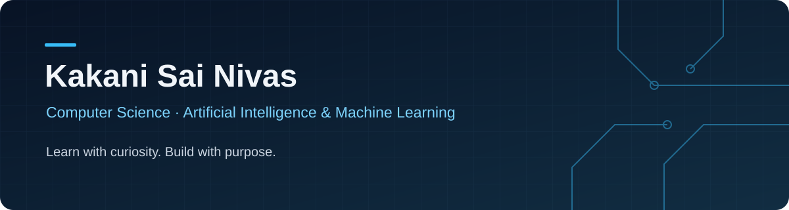
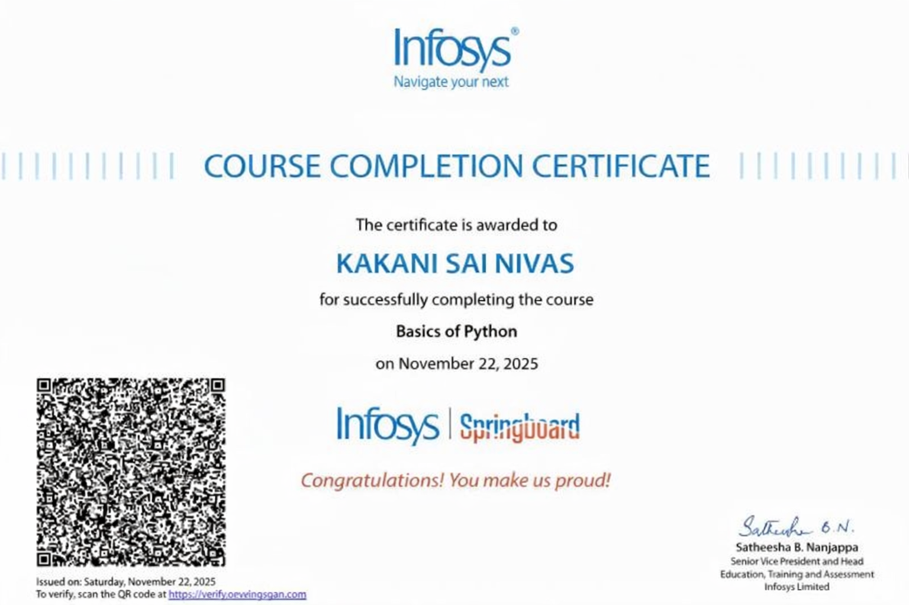

# Hi, I'm Kakani Sai Nivas 👋

**B.Tech CSE (AI & ML) Student · 3rd Year**

Exploring software development and AI/ML through practical applications.

## About me

I'm a third-year **B.Tech student in Computer Science and Engineering (Artificial Intelligence & Machine Learning)** at **Geethanjali Institute of Science and Technology (GIST), Nellore, Andhra Pradesh**.

I'm developing my skills in **Java, Python, web development, and data structures and algorithms**. My interests include software development, AI/ML, and building practical applications, especially tools for **crop protection and plant disease detection**.

## What I'm learning

| Area | Current focus |
| :--- | :--- |
| Programming | Developing my Java and Python skills |
| Web development | Learning to build applications for the web |
| Problem solving | Strengthening data structures and algorithms |
| AI & ML | Exploring applications in crop protection and plant disease detection |

  
  
  
  

## What I want to build

I'm interested in applying what I learn to:

- **Crop protection:** practical tools that support healthier crops.
- **Plant disease detection:** applications that explore AI/ML for identifying plant diseases.
- **Everyday problem solving:** useful software that addresses real needs.

## Featured projects

These educational adaptations were extended with Codex assistance. Original authorship and MIT licenses are preserved in each repository.

| Project | Description & improvements | Tech stack | Links |
| :--- | :--- | :--- | :--- |
| **Nivas CLI Lab** | API-powered CLI generator adaptation with configuration validation, an offline study API, and 18 regression tests. | TypeScript · Node.js · Vitest | [Repository](https://github.com/kakaninivas9/Nivas-CLI-Lab) · [Original source](https://github.com/adameehanairagroup/Aira-CLI-Kit) |
| **Nivas TinyLM Lab** | Character-level transformer training adaptation with explicit local datasets, configurable runs, improved checkpoints, and 6 regression tests. | Python · PyTorch · unittest | [Repository](https://github.com/kakaninivas9/Nivas-TinyLM-Lab) · [Original source](https://github.com/adameehanairagroup/Aira-AI-Non-Trained) |
| **Nivas Student AI Lab** | Student language-model learning project extended with model, dataset and sampling validation, improved checkpoint timing, and 5 regression tests. | Python · PyTorch · NumPy · unittest | [Repository](https://github.com/kakaninivas9/Nivas-Student-AI-Lab) · [Original source](https://github.com/adameehanairagroup/Aira-Ai-for-students) |

[Explore all my repositories](https://github.com/kakaninivas9?tab=repositories).

## Certificates

### Basics of Python — Infosys Springboard

- **Awarded to:** Kakani Sai Nivas
- **Completed:** November 22, 2025
- **Credential:** Course completion certificate

## Connect with me

I'm interested in connecting with people learning and building in **software development, AI/ML, and agricultural applications**.

- [LinkedIn — Sainivas Kakani](https://www.linkedin.com/in/sainivas-kakani/)
- [GitHub — kakaninivas9](https://github.com/kakaninivas9)

---

<i>Learn with curiosity. Build with purpose.</i>

